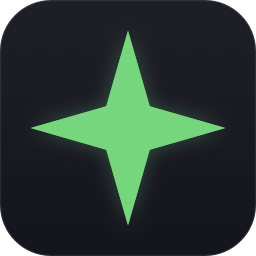
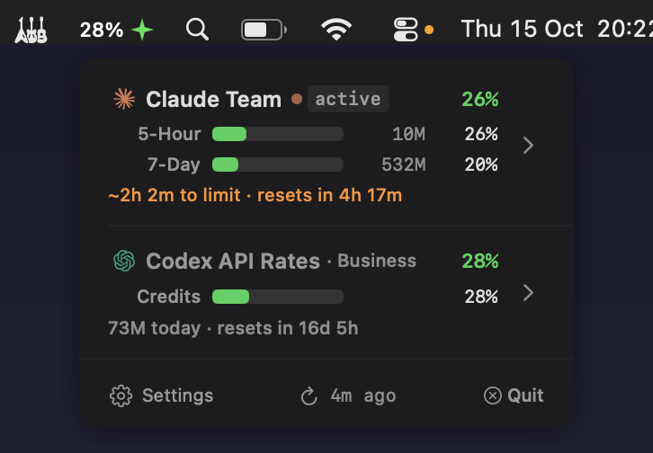
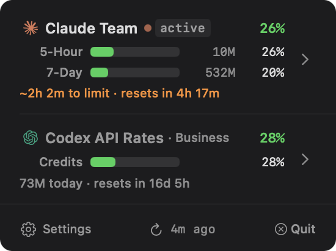
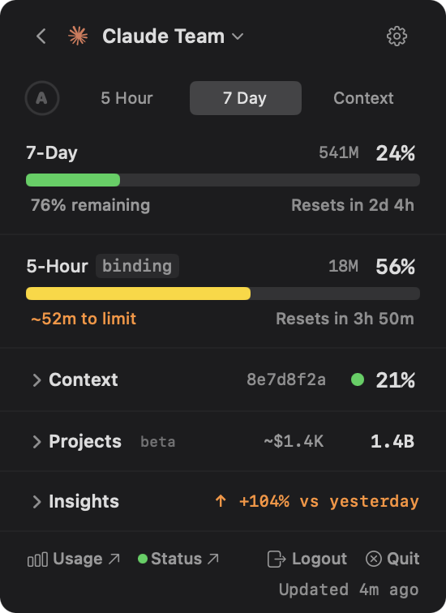
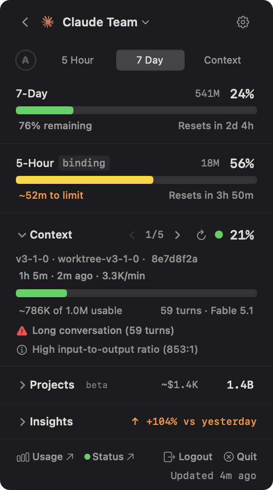
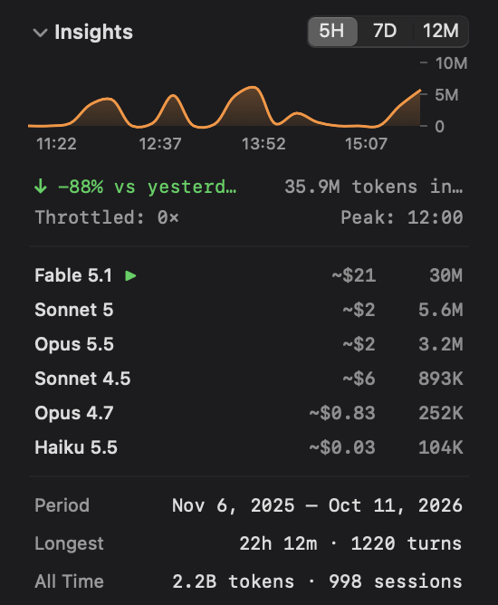
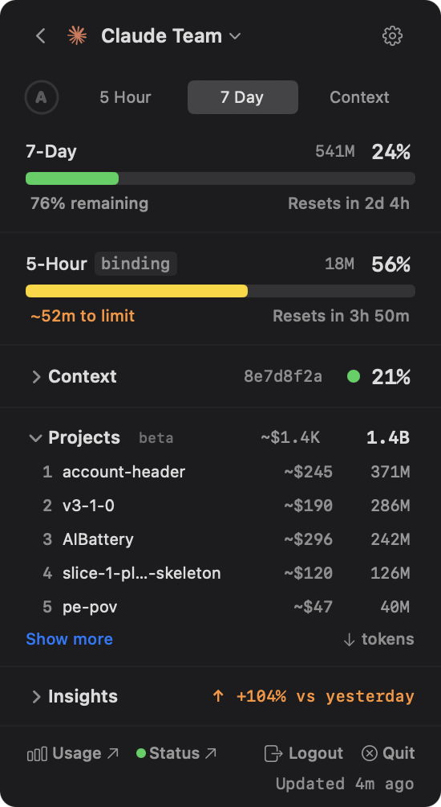
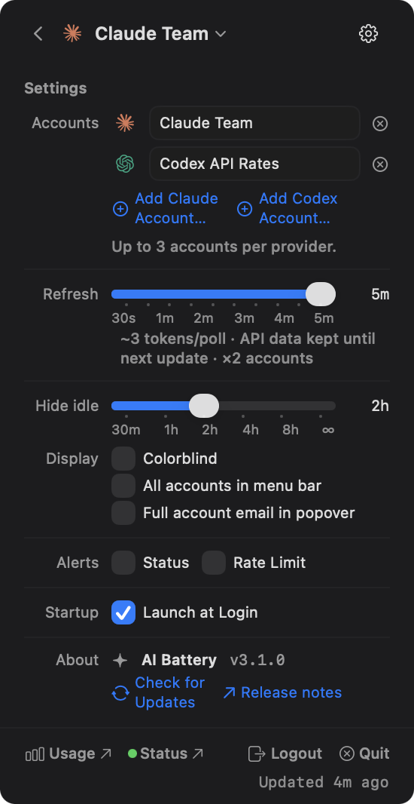

<div align="center">



# AI Battery

**Get the most out of your Claude and Codex subscriptions.**

[aibattery.dev](https://aibattery.dev)

Rate limits, context health and token usage for Claude Code **and** OpenAI Codex, every account on one screen, always visible in your macOS menu bar.

[](https://swift.org)
[](https://www.apple.com/macos/)
[](LICENSE)
[](https://github.com/KyleNesium/AIBattery/actions/workflows/ci.yml?query=branch%3Amain+event%3Apush)
[](https://github.com/KyleNesium/AIBattery/stargazers)
[](https://github.com/KyleNesium/AIBattery/releases)

<br/>



<p><strong>Every account's limits at a glance. Drill into any one for context health and usage trends.</strong></p>

</div>

## Install

**Homebrew** (recommended)

```bash
brew tap KyleNesium/tap
brew install --cask aibattery
```

<details>
<summary><strong>Quick install</strong> (paste in Terminal)</summary>

```bash
curl -sL https://github.com/KyleNesium/AIBattery/releases/latest/download/AIBattery.zip -o /tmp/AIBattery.zip && ditto -x -k /tmp/AIBattery.zip /Applications && xattr -cr /Applications/AIBattery.app && open /Applications/AIBattery.app
```

</details>

<details>
<summary><strong>DMG download</strong></summary>

Download from [Releases](https://github.com/KyleNesium/AIBattery/releases/latest), open `AIBattery.dmg` and drag **AI Battery** to **Applications**. macOS blocks the first launch because the app is not notarized: open **System Settings → Privacy & Security** and click **Open Anyway**, or run `xattr -cr /Applications/AIBattery.app`.

</details>

<details>
<summary><strong>Build from source</strong></summary>

```bash
git clone https://github.com/KyleNesium/AIBattery.git && cd AIBattery
./scripts/build-app.sh
open .build/AIBattery.app
```

</details>

Requires **macOS 13+** and [Claude Code](https://docs.anthropic.com/en/docs/claude-code) and/or the [Codex CLI](https://github.com/openai/codex). First-launch prompts (Gatekeeper, Keychain) are explained in the [FAQ](docs/FAQ.md).

## Update

AI Battery checks for updates once a day. When one is waiting, an arrow appears beside the Settings gear and stays until you install. Click it to update through [Sparkle](https://sparkle-project.org/), or right-click for release notes. The same controls live in **Settings → About**.

| Method | How |
|---|---|
| **In-app** (recommended) | Click the update arrow. Sparkle downloads, verifies, replaces and relaunches. |
| **Homebrew** | `brew upgrade --cask aibattery` |
| **DMG** | Download from [Releases](https://github.com/KyleNesium/AIBattery/releases/latest) and drag to Applications |

Settings and signed-in accounts carry over. Updates are user-initiated only; nothing downloads in the background.

## Sign in

OAuth 2.0 with PKCE for both providers, the same flows Claude Code and the Codex CLI use. Up to **3 Claude accounts** and **3 Codex accounts** side by side.

| Step | Claude | Codex |
|:---:|---|---|
| **1** | Launch AI Battery and pick **Claude** at the top of the sign-in screen | Pick **Codex** |
| **2** | **Sign In** opens Anthropic's sign-in page in your browser | **Sign In with ChatGPT** opens OpenAI's |
| **3** | Copy the authorization code and paste it into AI Battery | The browser redirects back to AI Battery on `localhost:1455`. Or skip the browser with **Import Codex CLI login**, which reads `~/.codex/auth.json` once |

**Codex plans.** ChatGPT subscriptions (Free, Plus, Pro, Team) show 5-hour and weekly windows plus any purchased-credit balance. Business and Enterprise spend-control plans show one **Credits** budget bar. API-key mode (`codex login --api-key`, or paste a key in the app) shows OpenAI's per-minute request and token limits and your real spend at API rates.

**Which account am I looking at?** The header chip shows the provider mark and the account identity: the alias you set in Settings, otherwise your sign-in email (Codex) or workspace name (Claude), otherwise "Claude 1" or "Codex 2". Emails are masked by default (`k•••@domain`; **Settings → Display → Full account email in popover** shows them in full). Click the chip to switch accounts or add one. Rate limits and identity are per account. Local token data (Insights, Projects, Context Health) is per provider, because every Codex account reads the same `~/.codex/sessions` and every Claude account the same `~/.claude`.

## All accounts at a glance

With two or more accounts the popover opens on an overview: one card per account.

<div align="center">

</div>

| On each card | |
|---|---|
| **Headline %** | The account's worst window, the same number the menu bar shows for it |
| **Bars** | 5-hour and 7-day (or Weekly) with tokens used in each window. Business plans show one **Credits** bar; API keys show per-minute limits with tokens used today |
| **State line** | Time to limit at the current burn rate, reset countdowns, **Limit reached**, **Throttled**, or **Cached** when the last fetch failed |
| **Live dot** | Breathes beside the name while that provider's CLI is in use (activity in the last 5 minutes) |
| **Status dot** | Appears only when the provider's status page reports degraded performance or an outage |

Click a card, or press `1`–`6`, to open that account. The **‹** chevron beside the account name goes back. The popover remembers where you were between opens. `R` refreshes every account; `Esc` steps back, then closes. With one account there is no overview and the popover opens straight on that account.

## Metrics

A minimal API fetch reads Claude Code account metadata for 5-hour and 7-day usage; Codex accounts read the ChatGPT usage endpoint, falling back to the newest Codex CLI session log. Local JSONL session logs (`~/.claude/projects`, `~/.codex/sessions`) provide token counts and context health, **never your message content**. Everything in the account view follows the active account's provider, and the footer **Usage** link opens that provider's usage dashboard.

The tab picker selects which metric drives the menu-bar colour. With two or more accounts the menu bar instead shows each account's worst window.

| Mode | Tracks | Best for |
|---|---|---|
| **5-Hour** | Burst rate limit | Knowing when you will be throttled |
| **7-Day** | Sustained rate limit | Pacing usage across the week |
| **Context** | Session context fullness | Knowing when to start fresh |
| **(A) Auto** | Whichever is most urgent | Always seeing the most critical limit |

**Auto mode** glows blue when active and follows whichever metric has the highest percentage. Clicking any tab switches back to manual.

> [!NOTE]
> The 5-hour and 7-day bars come from Anthropic's sliding-window account data. They can differ from Claude Code `/usage`, which uses different plan-usage semantics and reset timings. See the [FAQ](docs/FAQ.md#why-does-ai-battery-differ-from-claude-code-usage).

<div align="center">

</div>

## Context health

Shows your five most recent sessions with project name, git branch, duration and last activity. Browse with the `< 1/5 >` chevrons or swipe. Sessions idle for more than 30 minutes carry an amber **Idle** badge. The session line also shows what share of output was thinking (Claude) or reasoning (Codex) and the configured effort.

Percentages are relative to the model's full context window: 1M tokens for current Claude models, about 258K for GPT-5-family models via Codex. Keep 20–40% free for best results.

| Colour | Range | Meaning |
|---|---|---|
| Green | below 60% | Plenty of room |
| Orange | 60–80% | Quality may degrade |
| Red | above 80% | Start a fresh session |

<div align="center">

</div>

What context is, why it matters and what to do at orange or red: [FAQ → Context health](docs/FAQ.md#context-health).

## Activity and insights

Interactive charts across three windows:

| Mode | Window | Shows |
|---|---|---|
| **5H** | Trailing 5 hours | 15-minute token buckets, vs-yesterday trend, throttle count, peak hour |
| **7D** | Rolling 7 days | Daily activity, weekly trend, busiest day |
| **12M** | Rolling 12 months | Monthly activity, month-over-month trend, busiest month |

Below the chart: API-equivalent cost per model, throttle count and all-time totals (messages, sessions, longest session, date range).

With two or more ChatGPT-backed Codex accounts, each account's charts, Projects and Context Health show that account's own turns, attributed by the account id the Codex CLI stamps on each rollout. Turns from older CLI versions carry no stamp and are hidden rather than guessed; the caption says how many. Overview cards always show the provider's full totals.

<div align="center">

</div>

## API cost equivalent

Dollar amounts show what your usage **would have cost on the provider's pay-per-token API**, not your bill. Pro, Max and Team subscribers (and ChatGPT Plus, Pro, Team and Business Codex users) pay a flat fee. When the API equivalent exceeds that fee, the subscription is paying for itself. Pricing uses Anthropic's and OpenAI's published per-million-token rates.

The one exception is a **Codex API-key account**, where the costs are a real bill at OpenAI's rates and are shown without the `~` prefix.

<div align="center">

</div>

<details>
<summary><strong>How token and project tracking work</strong></summary>

AI Battery reads Claude Code's session logs (`~/.claude/projects/`) and stats cache (`~/.claude/stats-cache.json`), and the Codex CLI's rollouts (`~/.codex/sessions/`). It never writes to either tool's files and never reads message content, only token counts.

A persistent ledger (`~/Library/Application Support/AIBattery/token-ledger.json`) keeps a high-water mark per model so totals never drop when Claude Code rebuilds its cache. Codex has no stats cache, so its all-time figures start from the date AI Battery first scanned the logs.

**Projects** groups usage by the directory you ran the CLI in: every `.jsonl` log is scanned, deduplicated by message id, grouped by working directory and priced per project. Project data appears after your first session.

</details>

## Settings

Open Settings from the gear in the header, or **Settings** in the overview footer.

| Setting | What it does |
|---|---|
| **Add Claude / Codex account** | Connect another account of either provider, up to 3 per provider |
| **Account names** | Alias per account, shown in the header chip. The placeholder shows the sign-in email or workspace so you know which is which |
| **Auto mode** | Always show the most urgent metric |
| **Refresh** | Poll interval from 30 s to 5 min, per account. Claude costs about 3 tokens per refresh; Codex ChatGPT accounts cost nothing; Codex API keys spend about 16 output tokens per refresh at API rates |
| **Idle** | Hide sessions idle longer than 30 min to 8 h from Context Health, or never |
| **Full account email in popover** | Show sign-in emails unmasked (masked by default, safer when screen-sharing) |
| **Colorblind** | Blue, cyan, amber and purple palette |
| **All accounts in menu bar** | List every account's percent in the menu bar (`42% \| 23%`). Colour and countdown follow the worst account |
| **Alerts** | Notify on provider status-page outages |
| **Rate limit** | Notify when usage crosses a threshold (50–95%) |
| **Launch at login** | Start automatically |
| **About** | App version, **Check for Updates**, **Install**, **Release notes** |

<div align="center">

</div>

> [!TIP]
> Click any stat value (percentages, token counts, costs) to copy it.

## Privacy and security

| | |
|---|---|
| **Local only** | Reads Claude Code and Codex CLI JSONL for token counts, never message content (Codex `response_item` lines are never decoded). `~/.codex` is read-only |
| **Keychain** | OAuth refresh tokens live in the macOS Keychain (`kSecAttrAccessibleWhenUnlockedThisDeviceOnly`). Access tokens are memory-only |
| **Network** | `api.anthropic.com`, `console.anthropic.com`, `status.claude.com`; with a Codex account `chatgpt.com`, `auth.openai.com`, `status.openai.com`; with an API-key account `api.openai.com`; `api.github.com` (update check, daily) and `kylenesium.github.io` (Sparkle appcast) |
| **No tracking** | No analytics, no telemetry, no data collection |
| **Open source** | Every line is auditable, MIT licensed |
| **Release checks** | Each tagged release runs [`verify-release.sh`](scripts/verify-release.sh): codesign, Sparkle signatures, version consistency and bundle integrity, before the GitHub release is published |

Vulnerability reports: see [SECURITY.md](SECURITY.md).

## Accessibility

VoiceOver labels and hints on every interactive element, full keyboard navigation, a colorblind palette in Settings, and a three-step walkthrough on first launch.

## Architecture

```
AIBattery/
  Models/       — Data structs (AIProvider, UsageSnapshot, RateLimitUsage, TokenHealthStatus, ...)
  Services/     — OAuth, rate-limit fetchers, session-log readers, status checker (one per provider where it matters)
  ViewModels/   — UsageViewModel (@MainActor), routing by the active account's provider
  Views/        — SwiftUI popover, menu-bar label, sign-in screen
  Utilities/    — TokenFormatter, ModelNameMapper, ThemeColors, AppLogger
spec/           — Authoritative specs: ARCHITECTURE, DATA_LAYER, UI_SPEC, CONSTANTS
docs/           — FAQ and deferred work
```

One dependency, [Sparkle 2](https://sparkle-project.org/), for auto-update. Everything else is Apple frameworks. The `spec/` folder is the source of truth and is kept in sync with the code on every merge: [`ARCHITECTURE.md`](spec/ARCHITECTURE.md), [`DATA_LAYER.md`](spec/DATA_LAYER.md), [`UI_SPEC.md`](spec/UI_SPEC.md), [`CONSTANTS.md`](spec/CONSTANTS.md).

## Uninstall

```bash
brew uninstall --cask aibattery
```

Or quit from the menu bar and drag **AI Battery** from Applications to the Trash. To remove stored tokens, preferences and the token ledger as well, see [FAQ → Uninstall completely](docs/FAQ.md#uninstall-completely).

## Contributing and support

Read the [contributing guide](CONTRIBUTING.md) first. Version history is in [CHANGELOG.md](CHANGELOG.md); open questions and deferred work are in [docs/TODOS.md](docs/TODOS.md). Troubleshooting lives in the [FAQ](docs/FAQ.md).

AI Battery is free and open source. If it helps you get more out of your subscription, consider [sponsoring the project](https://github.com/sponsors/KyleNesium).

## Test Coverage

**1610 tests** across 125 test files.

| Area | Tests | What's covered |
|------|-------|----------------|
| Models | 419 | Rate-limit parsing for Claude and Codex, Claude plan from the OAuth profile (including spend-control credits and credit-budget runway), usage snapshots, spike and rollover filters, account readings and the fan-out gate, overview cards, popover mode and Escape routing, pricing tables, provider and account records |
| Services | 606 | Claude plan lookup (response handling, once-per-launch selection), Keychain read retry (a failed read stays signed in, one prompt, backoff, refusal), plan labels for both providers, Session-log readers for both providers (streaming, caching, oversized lines, concurrency), Codex per-account attribution and fallback gating, token ledger high-water marks and key migration, aggregation (one pass, two snapshots), OAuth managers (PKCE, refresh, error classification), rate-limit fetchers and backoff, Keychain, secure networking, status checker, notifications, Sparkle updates |
| Views | 230 | Menu-bar text and headline percent, panel refit trigger, icon hover motion (presets, Reduce Motion, layout never changes), header and back control, overview content, footer, activity chart transforms and trends, context-health display including thinking and effort text, Codex all-time captions, collapsible sections, settings hints, update arrow and About button states, transition bans for the headless runner |
| ViewModels | 101 | Multi-account fan-out (routing, carry-forward, generation stamp), refresh interval and adaptive polling, throttle tracking per account, stale rate-limit expiry, auth-error reconnect, cross-account refresh races, provider switching, off-main aggregation |
| Utilities | 254 | Token and duration formatting, percent display, model-name mapping, reasoning vocabulary, theme colours (provider tints, colorblind palette, hover strength), motion tokens, menu-bar icon rendering and cache, date formatters, JSONL newline scanning, email masking, logging redaction |

## License

[MIT](LICENSE)

The Claude and OpenAI marks in the account badge (`AIBattery/Resources/*.svg`) come from [Simple Icons](https://simpleicons.org) (CC0 1.0). The logos remain trademarks of Anthropic and OpenAI respectively; AI Battery is not affiliated with either.
